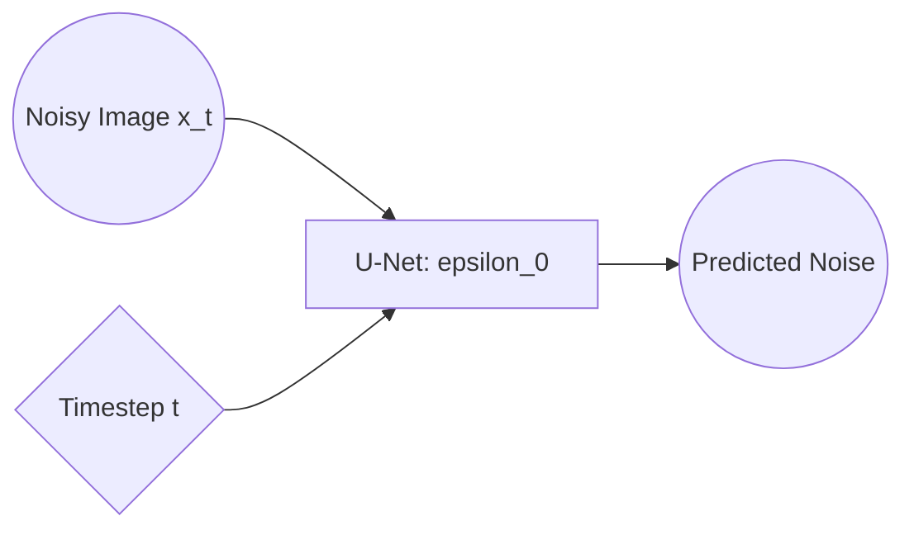

I am basing this post off of a video ([diffusion model tutorial](https://www.youtube.com/watch?v=JOqU8_qJQg4)) generated by [Zachary Huang](https://www.youtube.com/@ZacharyLLM).

A diffusion policy can formulated various different ways, although the most popular formulation is as a DDPM (Denoising Diffusion Probabalistic Model). It carefully adds noise to a sample from the prediction distribution until it resembles random noise. Then we will try to teach a neural network to predict the noise that was added. Lastly, we will start with a sample of random noise and then get the neural network to predict the noise until we get to a sample from the prediction distribution that we tried to estimate using the neural network.

We create the following classes to construct a basic diffusion model:

- DiffusionConfig: holds all the different configuration values that we want to pass to the diffusion model we want to train.
- SinusoidalPositionalEmbeddings: contains a way to embed the timestep t [^1] that we are on while denoising the random noise into a sample from the predicted distribution. This uses the same trick as Transformers.
- UNetBlock: construct a class to hold the sequence of transformations within a U-Net block/layer. We want it to take in the image and the timestep.
- SimpleUNetModel: contains the forward training method for training a UNet model using the UNetBlock class. We will use this as the noise predictor.
- DiffusionModel: class to noise the images from our training data using our DiffusionConfig class. We can use a reparameterization trick to instantly compute the value of the diffusion process at any timestep. We also define forward and sample methods. The forward method is a method for training the model. The sample method is used to obtain a random noise sample and then denoise it into a sample from the prediction distribution. The sample method is what we will call after we have a trained model offline [^2] to generate predictions.

#### [Single Forward Diffusion Step]

The forward process in Denoising Diffusion Probabilistic Models (DDPM) adds Gaussian noise to a data sample $x_0$ over $T$ steps according to a variance schedule $\beta_1, \beta_2, \dots, \beta_T$. The reparameterization trick allows sampling $x_t$ at an arbitrary time step $t$ directly from $x_0$ in closed form without iteratively sampling through all intermediate steps.

(1)

$$
x_{t} = \sqrt{\alpha_t}x_{t-1} + \sqrt{\beta_t}\epsilon
$$

where $x_t$ is the current noisy sample we predict using the previous noised sample $x_{t-1}$. $\alpha_t$ is the signal percentage and $\beta_t$ is the noise percentage. Both alpha and beta must obviously sum to 1.

This equation gives us the value of the noised sample after T timesteps, but in order to calculate T noise iterations over the original sample $x_0$ we recursively compute this value T times. For example, if we want to compute 500 timesteps, we would need to compute that equation 500 times in order to get the noised sample value at timestep T=500.

We can derive an equation to compute the noised sample at any timestep t by using the [reparameterization trick](#reparameterization-trick). The way we derive this is by taking the equation above where $x_{t-1} is the original state of the sample from the training data and $x_t$ is the state after we add a little noise, ie. $x_1$.

Expressing $x_{t-1}$ using the same definition:

(2)
$$x_{t-1} = \sqrt{\alpha_{t-1}} x_{t-2} + \sqrt{1 - \alpha_{t-1}} \epsilon_{t-2}, \quad \text{where } \epsilon_{t-2} \sim \mathcal{N}(0, \mathbf{I})$$

Substituting $x_{t-1}$ into the equation for $x_t$:

(3)
$$x_t = \sqrt{\alpha_t} \left( \sqrt{\alpha_{t-1}} x_{t-2} + \sqrt{1 - \alpha_{t-1}} \epsilon_{t-2} \right) + \sqrt{1 - \alpha_t} \epsilon_{t-1}$$

(4)
$$x_t = \sqrt{\alpha_t \alpha_{t-1}} x_{t-2} + \sqrt{\alpha_t (1 - \alpha_{t-1})} \epsilon_{t-2} + \sqrt{1 - \alpha_t} \epsilon_{t-1}$$

Recall that for two independent Gaussian random variables $X \sim \mathcal{N}(0, \sigma_1^2 \mathbf{I})$ and $Y \sim \mathcal{N}(0, \sigma_2^2 \mathbf{I})$, their linear combination yields:

(5)
$$X + Y \sim \mathcal{N}(0, (\sigma_1^2 + \sigma_2^2) \mathbf{I})$$

So if we say $A = \sqrt{\alpha_t (1 - \alpha_{t-1})} \epsilon_{t-2}$ and $B = \sqrt{1 - \alpha_t} \epsilon_{t-1}$:

- Variance of $A$: $\alpha_t (1 - \alpha_{t-1})$ (refer to eqn 4)
- Variance of $B$: $1 - \alpha_t$ (refer to eqn 4)

Summing the variances gives:

(6)
$$\sigma_{\text{combined}}^2 = \alpha_t (1 - \alpha_{t-1}) + (1 - \alpha_t) = \alpha_t - \alpha_t \alpha_{t-1} + 1 - \alpha_t = 1 - \alpha_t \alpha_{t-1}$$

Therefore, the combined noise term can be written as a single scaled Gaussian noise vector $\sqrt{1 - \alpha_t \alpha_{t-1}} \bar{\epsilon}_{t-2}$, where $\bar{\epsilon}_{t-2} \sim \mathcal{N}(0, \mathbf{I})$:

(7)
$$x_t = \sqrt{\alpha_t \alpha_{t-1}} x_{t-2} + \sqrt{1 - \alpha_t \alpha_{t-1}} \bar{\epsilon}_{t-2}$$

Therefore, we can use the additivity of variance property which says if we have two uncorrelated distributions then we add the variances together. Secondly, we assume Gaussian distributions that have a mean of 0 which means we can use a simplified equation for adding the variances together, $Var(X+Y) = Var(X) + Var(Y)$. We want to multiply the variances together which can be derived from the additivity of variance property as a special case. So we can easily multiply the independent, zero mean Gaussian distribution variances to return the variance of the noised sample at timestep T.

(8)
$$\bar{\alpha}_{T}=\prod_{i=0}^{T} (1- \beta_i)$$
where $\beta_i$ is the variance at that iteration given by the variance schedule that we decide. Remember $\alpha_i=(1-\beta_i)$.

**All of this means that when we try to solve for $x_{500}$, for example, we can say $\bar{\alpha}_{500}=\prod_{i=0}^{500} (1-\beta_i)$**

#### [Reparameterization Trick]

(9)

$$
x_t = \sqrt{\bar{a_t}}x_0 + \sqrt{1-\bar{a_t}}\epsilon
$$

where $x_0$ is a sample from our training data, $\epsilon$ is a random noise sample, and $x_t$ is a noisy sample at timestep t.

Alpha represents the signal strength while beta represents the noise strength. We can adjust the beta to increase or decrease the signal strength since they must both sum to 1. We square the values of alpha and beta in the [equation above](#reparameterization-trick) so the variances sum to 1. $\alpha_t + \beta_t = 1$ $\alpha$ and $\beta$ must sum to 1.

#### Reverse Diffusion Step

Given a noisy image, is it possible to estimate what the unnoised image was? Reversing the diffusion step is mathematically intractable because it means we must run each forward pass over the entire dataset in order to figure out which image noise was added to.

When trying to perform the reverse diffusion step, we predict the original sample by rearranging the [reparameterization formula](#reparameterization-trick) so we can solve for $x_0$. We already know the $x_t$ and if we can predict the noise, $\epsilon$ then we can compute the $x_0$. In order to predict $\epsilon$, we need to select a model that can take a random noise sample and then return an output of the same dimension given a specific timestep. A common model used for applications where we have the same size input and output is the U-Net model.

So we will call our U-Net the noise predictor model and it will take a noisy image and timestep t and then return the predicted noise which will have the same shape as the noisy image. We denote this as:

$$
\epsilon_0(\mathbf{x}_t,t) \approx \epsilon
$$

$$
x_{t-1} = \frac{1}{\sqrt{a_t}}(x_t - \frac{1-a_t}{\sqrt{1-\bar{a_t}}}\epsilon_0) + \sigma_t\bar{z}
$$

where $x_t$ is the current noisy sample and $x_{t-1}$ is a sample that is slightly cleaner than $x_t$. $\bar{\alpha_t}$ is just the cumulative product of the $\alpha_t$ over every timestep we are trying to cover.

This [equation](#reparameterization-trick) can be derived by taking the [single forward diffusion step](#single-forward-diffusion-step) function and inputting the next x_t. So for the first iteration of that equation we have $

#### Loss Function

$$
L=MSE(\epsilon,epsilon_0)
$$

where $\epsilon$ is the real noise in the image and $\epsilon_0$ is the predicted noise from our UNet Model.

So far we have calculated the forward diffusion process along with a reparameterization trick, found a way to estimate the reverse diffusion process, and now we can use the loss function to update our model weights for tuning a function to predict the noise in a noisy image. We have the ground truth label (ie the noise $\epsilon$ from our training data) and we have the prediction from the model. So we have everything we need to compute the MSE (mean squared error).

Once we compute the loss (MSE), then we can use an optimizer like SGD (Stochastic Gradient Descent) to update the model weights.

### Sinusoidal Positional Embeddings

[^1]: Some researchers also call this the iteration step

[^2]: Offline means assume the model will operate in the same prediction range as our training data. We are not able to update the model without retraining it completely on the new data. Online means that we can update our model as we receive new data.
